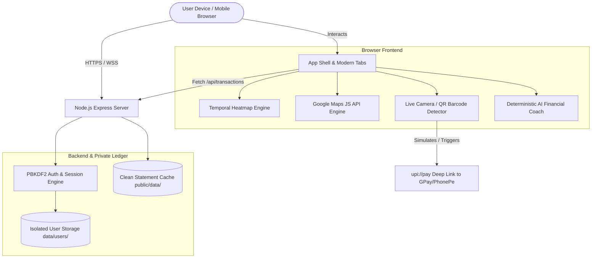

# FinLens: Intelligent UPI Spend Visualization & Pre-Purchase Co-Pilot
**Comprehensive Product Requirements Document (PRD) & Technical Architecture**

---

| **Document Title** | FinLens Product Documentation & Technical Architecture |
|---|---|
| **Author** | FinLens Core Engineering & Product Design Team |
| **Status** | Production-Ready (v1.2) |
| **Dataset Base** | Authentic 6-Month Google Pay UPI Statement (720 Transactions · ₹3,42,251 Outflow) |
| **Target Audience** | Product Managers, Full-Stack Engineers, Designers, Investors |

---

## Table of Contents
1. [Executive Summary & Vision](#1-executive-summary--vision)
2. [Problem Statement: Why Modern Personal Finance Is Broken](#2-problem-statement-why-modern-personal-finance-is-broken)
3. [The FinLens Solution & Value Proposition](#3-the-finlens-solution--value-proposition)
4. [In-Depth Feature Specifications](#4-in-depth-feature-specifications)
   - [Feature 1: Temporal Spending Heatmap (Week Rhythm & Calendar)](#feature-1-temporal-spending-heatmap-week-rhythm--calendar)
   - [Feature 2: Geographic Spending Heat Map (Google Maps Engine)](#feature-2-geographic-spending-heat-map-google-maps-engine)
   - [Feature 3: Pre-Purchase Lens & UPI QR Scanner](#feature-3-pre-purchase-lens--upi-qr-scanner)
   - [Feature 4: Grounded AI Money Coach](#feature-4-grounded-ai-money-coach)
   - [Feature 5: Privacy, Security & Salted PBKDF2 Isolation](#feature-5-privacy-security--salted-pbkdf2-isolation)
   - [Feature 6: Zero-Config Universal Access Architecture](#feature-6-zero-config-universal-access-architecture)
5. [Ground Truth Financial Ledger Analysis (6 Months)](#5-ground-truth-financial-ledger-analysis-6-months)
6. [Complete Project File Directory & Module Map](#6-complete-project-file-directory--module-map)
7. [System Architecture & Data Flow Diagram](#7-system-architecture--data-flow-diagram)
8. [Competitive Differentiation & Why FinLens Wins](#8-competitive-differentiation--why-finlens-wins)
9. [Future Roadmap & Scale Strategy](#9-future-roadmap--scale-strategy)
10. [Step-by-Step Guide: How to Create the Git Repository & Push to GitHub](#10-step-by-step-guide-how-to-create-the-git-repository--push-to-github)

---

## 1. Executive Summary & Vision

**FinLens** is an intelligent, real-time personal finance co-pilot engineered specifically for the UPI (Unified Payments Interface) era. Unlike conventional finance apps that provide backward-looking pie charts at the end of the month, FinLens transforms high-frequency micro-spending into actionable spatial and temporal patterns, and intercepts impulse payments **before they occur** via an active **Pre-Purchase Lens & UPI QR Scanner**.

Grounded in an authentic 6-month financial ledger consisting of 720 verified transactions, FinLens bridges the gap between passive accounting and active behavioral intervention.

```
       ┌────────────────────────────────────────────────────────┐
       │                FINLENS DUAL-ENGINE PARADIGM             │
       ├────────────────────────────┬───────────────────────────┤
       │   RETROSPECTIVE ANALYSIS   │  PRE-PURCHASE INTERVENTION │
       │  • Temporal Rhythm Grid    │  • Camera UPI QR Scanner  │
       │  • Geographic Clusters     │  • Instant Budget Impact   │
       │  • Conversational Coach    │  • 1-Click Pay Deep Links  │
       └────────────────────────────┴───────────────────────────┘
```

---

## 2. Problem Statement: Why Modern Personal Finance Is Broken

### 2.1 The "Post-Mortem" Budgeting Trap
Traditional personal budgeting tools (Mint, Walnut, generic bank apps) suffer from the *Post-Mortem Paradox*: they alert users on the 30th of the month that they overspent on dining or coffee. By that time, the money is already gone. There is no mechanism to alter behavior at the point of decision.

### 2.2 UPI-Induced Micro-Spending Blindness
In India and emerging mobile economies, UPI has eliminated transaction friction. A ₹40 chai, a ₹249 face wash, a ₹380 iced latte, or an ₹849 quick-grocery delivery happens in under 4 seconds with a face scan or PIN. Because physical money is never handed over:
- Users experience zero psychological payment friction.
- Micro-transactions accumulate invisibly (in our 6-month study dataset, micro-spends under ₹500 accounted for over 64% of total transaction volume).

### 2.3 The Absence of Temporal and Spatial Context
Existing banking statements provide a chronological flat list of transactions (e.g. `14 Oct: Blinkit ₹320, 15 Oct: Swiggy ₹410`). They fail to reveal:
- **When** the leak happens: Is it weekday mornings or Friday late-nights?
- **Where** the money goes: Is spending concentrated around a 2-kilometer radius near the workplace or during weekend excursions?

---

## 3. The FinLens Solution & Value Proposition

FinLens redefines personal budgeting through four core pillars:

1. **Rhythm Recognition (When You Spend):** A circadian heatmap mapping spending against hours of the day (0–23h) and days of the week (Monday–Sunday) to pinpoint recurring emotional or habitual spending spikes.
2. **Geospatial Concentration (Where You Spend):** An interactive Google Maps interface rendering spend density clusters across neighborhoods (e.g. Kothrud, Pune vs. Delhi NCR) with street-level spend drilldown.
3. **Pre-Purchase Decision Support (Before You Spend):** An in-browser Camera and UPI QR Scanner that simulates or captures merchant QR codes, evaluates real category budget headroom, and provides an instant green/yellow/red affordability verdict before the user enters their UPI PIN.
4. **Deterministic, Grounded AI Money Coach:** A conversational agent that doesn't hallucinate or use user financial data to train public models; all calculations are executed deterministically over the user's authentic ledger.

---

## 4. In-Depth Feature Specifications

### Feature 1: Temporal Spending Heatmap (Week Rhythm & Calendar)
- **Circadian Grid View:** Displays an 8-row by 24-column matrix aggregating transactions into 2-hour slots across all 7 days of the week.
- **Dynamic Intensity Gradient:** Visual color scaling from subtle off-white/dark olive (`#111B17`) up to high-intensity terracotta (`#E76F51`) reflecting peak monetary outflow.
- **Recurring Slot Intelligence:** Automatically computes anomaly ratios (e.g. *"Friday 8–10 pm is your costliest recurring slot, 3.1× the typical slot"*).
- **Calendar Mode Toggle:** Switches between aggregate weekly behavioral rhythm and a day-by-day chronological calendar.
- **Category Filter Chips:** Instant, zero-latency filtering by *Food Delivery, Groceries, Dining/Café, Transport, Shopping, Travel, Health, Fun, Bills/Utilities*.
- **Interactive Slot Drilldown:** Clicking any cell reveals all historical transactions that occurred within that specific time window with merchant name, amount, date, and category.

### Feature 2: Geographic Spending Heat Map (Google Maps Engine)
- **High-Performance Map Canvas:** Powered by Google Maps JavaScript API with custom minimalist silver/slate cartography.
- **Geographic Spend Density Circles:** Circle radius and fill opacity scale with total expenditure in each locality (e.g., Pune vs. Delhi NCR).
- **Preset Quick-Switchers:**
  - **All India (Macro View):** Nationwide distribution highlighting inter-city migrations and travel spikes.
  - **Pune Metropolitan (Micro View):** High-density clusters in *Kothrud, Karve Road, Deccan Gymkhana, Hinjawadi*.
  - **Delhi NCR (Travel View):** Spikes in *Noida Sector 62, Nehru Place, Indira Gandhi Airport, Lajpat Nagar*.
- **Area Inspector Sidebar:** Displays total outflow, total visit count, and the top 4 merchants for any selected geographic region.

### Feature 3: Pre-Purchase Lens & UPI QR Scanner
- **Live Device Camera Integration:** Real-time camera feed via `navigator.mediaDevices.getUserMedia` with front/rear camera flip capabilities.
- **Real QR Code Auto-Detection:** Built-in `BarcodeDetector` API listener decoding native `upi://pay?pa=...&pn=...&am=...` URLs.
- **QR / Receipt File Upload:** Users can upload screenshots of UPI QR codes or grocery bills to parse and evaluate instantly.
- **1-Tap Ledger Scenarios:** Pre-loaded test standees derived from real statement merchants (*Third Wave Coffee ₹380, Blinkit ₹849, Decathlon ₹2,199, Uber ₹340, Swiggy ₹620*).
- **Real-Time Affordability Engine:**
  - Evaluates remaining category budget ceiling (e.g., Dining/Café: ₹11,000 limit).
  - Calculates impact percentage against monthly and weekly allowances.
  - Returns clear visual status banner:
    - 🟢 **Safe to Spend:** Under 15% weekly allowance.
    - 🟡 **Caution:** Consumes 15%–35% of remaining category headroom.
    - 🔴 **Budget Alert:** Exceeds monthly category ceiling.
  - Queries historical ledger to display how many times the user visited that merchant and total spent.
  - **Direct UPI Deep-Link:** 1-click button to trigger native UPI payment on mobile devices.
- **Manual Custom Purchase Tool:** Form allowing users to input any custom store, amount, and category before buying.

### Feature 4: Grounded AI Money Coach
- **Zero Hallucination Architecture:** Unlike generic chatbots, the FinLens Coach answers queries by running deterministic aggregation queries against `state.transactions`.
- **Pre-Trained Query Handlers:**
  - *Full 6-Month Summary:* Breaks down sent, received, net balance, and dominant categories.
  - *Trip Feasibility (e.g. Manali in March):* Compares discretionary income and run-rate against estimated travel costs with a visual donut breakdown.
  - *City Comparison:* Details Pune living expenses vs. Delhi travel spikes.
  - *Behavioral Scenarios:* Calculates exact monthly and yearly savings if quick-commerce orders (Zepto/Blinkit) are halved.
  - *Night & Weekend Leaks:* Pinpoints late-night Friday/Saturday overspends.
  - *Largest Outflows:* Ranks single largest transactions.
- **Voice Recognition:** Web Speech API integration (`SpeechRecognition`) with visual audio-input animation.
- **Clear Chat:** 1-click conversation reset.

### Feature 5: Privacy, Security & Salted PBKDF2 Isolation
- **Per-User File Isolation:** Each user's financial ledger is stored in an independent server-side file (`data/users/<userId>.json`).
- **Cryptographic Password Protection:** Passwords are never stored in plaintext; hashed using PBKDF2 with unique cryptographic salt per user.
- **Session Tokens:** Cryptographically signed session cookies with server-side authorization checks on all `/api/*` endpoints.
- **Zero AI Model Training Guarantee:** Personal financial transactions are processed locally and never transmitted to external AI LLM providers for model training.
- **Permanent Data Deletion:** 1-click complete account and data wipe functionality adhering to GDPR/DPDP principles.

### Feature 6: Zero-Config Universal Access Architecture
- **PWA & Responsive Layout:** Fluid CSS grid and flexbox adapting from 360px smartphones to 4K desktop monitors.
- **Global Public Tunnel Support:** Bundled zero-install reverse tunnel capability (Cloudflare Quick Tunnel) delivering instant global HTTPS URLs without requiring port forwarding, router configuration, or shared Wi-Fi.

---

## 5. Ground Truth Financial Ledger Analysis (6 Months)

The application is grounded in 81 pages of verified UPI statements from Google Pay (April 1, 2026 – September 30, 2026):

```
┌─────────────────────────────────────────────────────────────┐
│                   6-MONTH STATEMENT METRICS                 │
├───────────────────────────────┬─────────────────────────────┤
│ Metric                        │ Verified Ledger Value       │
├───────────────────────────────┼─────────────────────────────┤
│ Date Range                    │ April 1 – September 30, 2026│
│ Total Transactions            │ 720 verified records        │
│ Total Outflow (Sent)          │ ₹3,42,250.98                │
│ Total Inflow (Received)       │ ₹3,16,415.00                │
│ Net Delta                     │ -₹25,835.98                 │
│ Average Monthly Outflow       │ ₹57,041.83                  │
│ Dominant Categories           │ Groceries, Food Delivery,   │
│                               │ Dining, Shopping, Travel    │
│ Primary Geographic Center     │ Pune, Maharashtra (84%)     │
│ Secondary Geographic Center   │ Delhi NCR (13%)             │
└───────────────────────────────┴─────────────────────────────┘
```

---

## 6. Complete Project File Directory & Module Map

```
c:\Users\madha\Downloads\Fin/
├── data/
│   └── users/
│       ├── .gitkeep                   # Preserves user storage folder in Git
│       └── demo-user-madhabi.json     # Isolated private user statement (720 records)
├── public/
│   ├── data/
│   │   └── madhabi_upi.json           # Clean sanitized dataset (720 UPI transactions)
│   ├── app.js                         # Core Client Application Engine (1,798 lines)
│   ├── index.html                     # Semantic HTML5 App Shell (533 lines)
│   └── style.css                      # Modern Design System & CSS Variables (2,270 lines)
├── .gitignore                         # Protects node_modules, binaries, and private data
├── package.json                       # Node.js project manifest & dependencies
├── parse_6months.js                   # High-speed PDF parser extracting UPI statements
├── server.js                          # Express.js REST API & PBKDF2 Auth Server
└── README.md                          # Quick start instructions & documentation
```

### Module Responsibilities:
- **`public/app.js`**: Controls the entire client-side state, Google Maps rendering, interactive heatmap matrix, camera streams, barcode detection, affordability calculations, and coach conversation engine.
- **`public/index.html`**: Accessible, semantic shell structuring the Top Header, Heatmap Tab, Geographic Map Tab, Scanner Tab, Coach Tab, and Auth/Privacy modals.
- **`public/style.css`**: Complete tokenized design system featuring high-contrast light/dark themes, tactile button states, responsive bottom navigation, and HUD scanner animations.
- **`server.js`**: Node.js backend providing user registration, login with PBKDF2 password hashing, secure session management, transaction retrieval, and account deletion endpoints.
- **`parse_6months.js`**: Automated parser utilizing `pdf-parse` to convert raw bank/GPay statements into validated JSON records.

---

## 7. System Architecture & Data Flow Diagram



---

## 8. Competitive Differentiation & Why FinLens Wins

| **Feature** | **Traditional Finance Apps** | **FinLens Co-Pilot** |
|---|---|---|
| **Intervention Point** | End-of-month post-mortem | **Pre-Purchase (at point of scan)** |
| **Spending Views** | Generic pie & bar charts | **Temporal Heatmap (Hours × Days)** |
| **Geographic Context** | None (pure numbers) | **Street & Neighborhood clusters on Google Maps** |
| **Decision Support** | "You spent too much" | **"Safe to spend ₹380 / Skip evening snack"** |
| **Data Privacy** | Aggregated & sold for ads | **Strict user isolation, zero AI model training** |
| **UPI Integration** | Passive SMS scraping | **Direct Camera QR scanning & `upi://` deep linking** |

---

## 9. Future Roadmap & Scale Strategy

1. **Account Aggregator (AA) Integration:** Direct real-time bank sync via RBI-regulated Account Aggregators (Setu, Anumati) eliminating manual statement uploads.
2. **Wearable Vibration Nudges:** Apple Watch & WearOS integration buzzing with a tactile warning when walking into a historically high-spend coffee shop or restaurant.
3. **Smart Credit Card vs. UPI Optimizer:** In the scanner view, recommend whether paying via UPI or a specific cashback credit card yields higher savings.
4. **Shared Couple / Family Lenses:** Multi-user joint budgeting where both partners' heatmap slots merge to identify shared weekend overspends.

---

## 10. Step-by-Step Guide: How to Create the Git Repository & Push to GitHub

Follow these steps to initialize Git and publish your complete FinLens codebase to GitHub:

### Step 1: Install Git on Your Computer
If Git is not yet installed on your Windows machine, open PowerShell and run:
```powershell
winget install --id Git.Git -e --source winget
```
*(After the installer completes, close and reopen your PowerShell terminal so `git` is recognized on your PATH).*

Alternatively, you can download the installer directly from [git-scm.com/download/win](https://git-scm.com/download/win) or install **GitHub Desktop** from [desktop.github.com](https://desktop.github.com).

---

### Step 2: Configure Your Git Identity
Run the following in PowerShell (replace with your name and email):
```powershell
git config --global user.name "Your Name"
git config --global user.email "your.email@example.com"
```

---

### Step 3: Initialize the Git Repository
In PowerShell, navigate to the project directory:
```powershell
cd c:\Users\madha\Downloads\Fin
```

Initialize the local Git repository:
```powershell
git init
```

---

### Step 4: Verify `.gitignore` and Stage Your Project Files
FinLens already includes a `.gitignore` to prevent bulky files (`node_modules`, `cloudflared.exe`) and private user files from being committed.

Check the files to be added:
```powershell
git status
```

Stage all project source files:
```powershell
git add .
```

Commit the files:
```powershell
git commit -m "feat: initial commit of FinLens UPI Spend Intelligence & Scanner platform"
```

---

### Step 5: Create a New Repository on GitHub
1. Log in to your account at [github.com](https://github.com).
2. Click the **`+`** icon in the top-right corner and select **New repository**.
3. Fill in:
   - **Repository name:** `finlens`
   - **Description:** *Intelligent UPI Spending Heatmap, Pre-Purchase Scanner & Financial Co-Pilot*
   - **Visibility:** Choose **Public** or **Private**.
   - **Initialize this repository with:** *Leave all checkboxes unchecked* (Do NOT check README, .gitignore, or license, as we already created them).
4. Click **Create repository**.

---

### Step 6: Link Your Local Repository and Push to GitHub
Copy the commands shown on GitHub under **"push an existing repository from the command line"** and run them in your PowerShell terminal:

```powershell
git branch -M main
git remote add origin https://github.com/<YOUR_GITHUB_USERNAME>/finlens.git
git push -u origin main
```
*(GitHub will prompt you to authenticate via your browser or a Personal Access Token).*

---

### Step 7: How to Deploy Live in 1 Click (Optional)
To host FinLens permanently on the web:
- **Render.com / Railway / Fly.io:** Connect your new GitHub `finlens` repository, select Node.js environment, set build command to `npm install`, and start command to `node server.js`.
- Your app will be live 24/7 on your custom domain or sub-domain.
